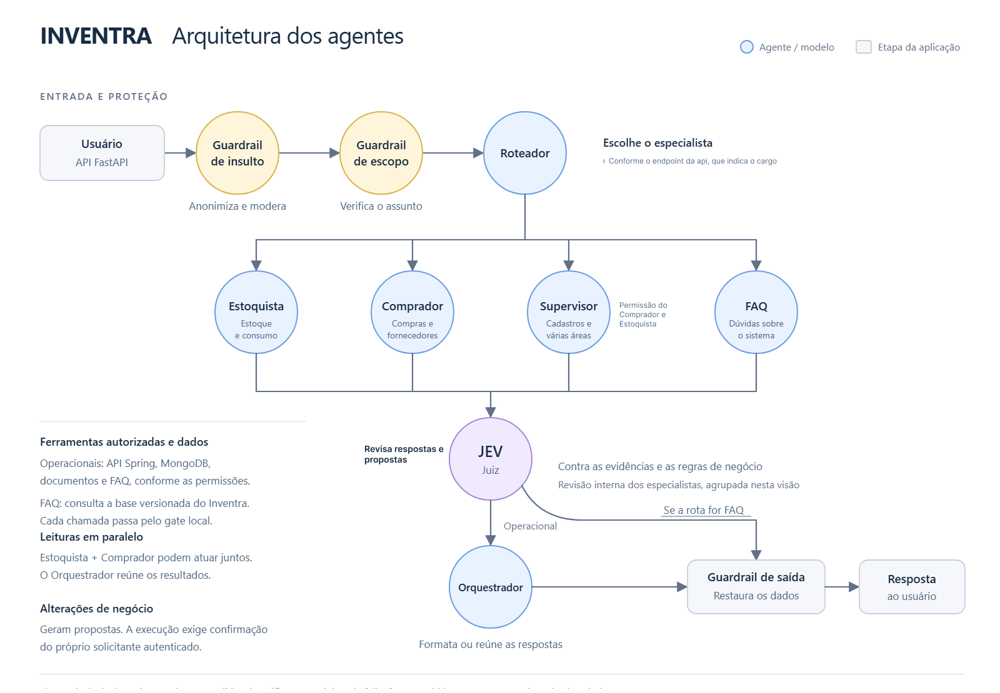

# IAI Inventra

Assistente de IA do Inventra, feito com **FastAPI + LangChain + LangGraph**. Responde dúvidas sobre o
sistema, consulta estoque, compras e cadastros e **propõe** alterações de negócio, que só são executadas
depois da confirmação do próprio solicitante autenticado.

## Sumário

- [Como funciona](#como-funciona)
- [Executar localmente](#executar-localmente)
- [Configuração](#configuração)
- [API](#api)
- [Agentes e tools](#agentes-e-tools)
- [Aprovação de alterações](#aprovação-de-alterações)
- [Integração com a API Spring](#integração-com-a-api-spring)
- [Servidor MCP](#servidor-mcp)
- [Documentos como contexto](#documentos-como-contexto-arquivos--qdrant)
- [Métricas e observabilidade](#métricas-e-observabilidade)
- [Testes](#testes)
- [Deploy](#deploy)

## Como funciona



Todo turno de conversa segue o mesmo fluxo:

1. **Guardrail de insulto:** anonimiza dados sensíveis e modera a mensagem.
2. **Guardrail de escopo:** verifica se o assunto pertence ao Inventra.
3. **Roteador:** escolhe o especialista conforme o endpoint da API e o cargo do usuário.
4. **Especialistas:** Estoquista, Comprador, Supervisor ou FAQ. Estoquista e Comprador podem ler em paralelo.
5. **JEV (juiz):** revisa as respostas e propostas contra as evidências e as regras de negócio. Se a rota for FAQ, a resposta segue direto para o guardrail de saída.
6. **Orquestrador:** formata ou reúne as respostas dos especialistas.
7. **Guardrail de saída:** restaura os dados anonimizados e entrega a resposta ao usuário.

Regras que valem em todo o fluxo:

- **Ferramentas autorizadas.** Cada chamada de tool passa por um [gate local](iai/app/core/assistant/tool_gate.py)
  antes de executar. Operacionais usam a API Spring, o MongoDB, documentos e o FAQ, conforme as permissões do cargo.
- **FAQ.** Consulta a base versionada do Inventra ([`iai/data/faq_inventra.jsonl`](iai/data/faq_inventra.jsonl)).
  Se o modelo falhar ou o JEV reprovar, devolve o trecho literal da documentação.
- **Alterações de negócio** geram propostas. A execução exige confirmação do próprio solicitante autenticado.
  O JEV não substitui essa aprovação humana.
- **JEV ([revisão](iai/app/core/assistant/review.py)).** Uma chamada por turno. Em escrita, julga cada proposta
  (`propor_*`); em leitura e FAQ, o texto final contra o que as tools devolveram. Proposta reprovada é cancelada e o
  especialista roda mais uma vez com os critérios que falharam. Sem `TYPESAFE_API_KEY` (ou com o JEV fora do ar), a
  escrita fica indisponível e a leitura segue sem o juiz.
- **Leituras paralelas.** Leituras independentes (`consultar_inventra`, `faq_retriever`, `buscar_historico`,
  `buscar_documentos`) podem sair no mesmo lote, com concorrência máxima de quatro. Lotes com proposta rodam uma
  etapa por vez.

### Estrutura do código

| Caminho | Conteúdo |
|---|---|
| `iai/app/main.py` | App FastAPI, CORS, `/health` |
| `iai/app/core/assistant/` | Grafo LangGraph, guardrails, JEV, prompts, memória, gate de tools |
| `iai/app/core/business/` | Domínio, propostas, aprovações e `SpringGateway` |
| `iai/app/core/tools/` | Tools dos agentes (operacionais, FAQ, documentos, memória) |
| `iai/app/core/files/` | Upload seguro, extração, guardrail e indexação no Qdrant |
| `iai/app/core/routes/` | Rotas HTTP |
| `iai/app/core/infra/` | Métricas, privacidade, retrieval, segurança, storage |
| `iai/app/extras/` | Demo, áudio (Whisper) e servidor MCP |
| `tests/` | Testes automatizados |

## Executar localmente

Requer Python 3.12.

```powershell
pip install -r requirements.txt
copy iai\.env.example iai\.env
python -m uvicorn iai.app.main:app --host 127.0.0.1 --port 8000
```

- Não sobrescreva um `.env` existente.
- Documentação interativa (Swagger): `http://127.0.0.1:8000/docs`.
- Estado e modos: `GET /health` e cabeçalhos `X-IAI-*`.

O `.env.example` já sobe o **modo demonstração**: usuários fixos, estoque de exemplo, Mongo simulado em memória e
um intérprete limitado, sem provedores de IA. Não é autenticação real, não consulta estoque real e perde dados ao
reiniciar. Para persistir propostas e histórico, use `IAI_STORAGE_MODE=mongo` e `MONGO_CONNECTION`.

> Se a instalação pedir `pg_config` ou compilador C++, confira a versão do Python e o `requirements.txt`: o IAI não
> usa `jq` nem `psycopg2-binary`; o acesso ao PostgreSQL é feito pela API Spring.

### Identidades de demonstração

Envie `Authorization: Bearer <identificador>`. São dados públicos de exemplo, não credenciais de produção, e os
modos mock nunca devem ser expostos publicamente.

| Identificador | Cargo | Cozinha |
|---|---|---|
| `demo-estoquista` | Estoquista | 1 |
| `demo-comprador` | Comprador | 1 |
| `demo-supervisor` | Supervisor | 1 |
| `demo-outra-cozinha` | Supervisor | 2 |

### Testar no celular (mesma rede Wi-Fi)

1. Suba o servidor com `--host 0.0.0.0`.
2. Descubra o IP do PC:
   ```powershell
   (Get-NetIPAddress -AddressFamily IPv4 | Where-Object { $_.InterfaceAlias -match "Wi-Fi|Ethernet" }).IPAddress
   ```
3. No celular, abra `http://<IP-do-PC>:8000/docs` e use **Authorize** com o token de um perfil demo.
4. Se não abrir, libere a porta (PowerShell como administrador):
   ```powershell
   New-NetFirewallRule -DisplayName "IAI 8000" -Direction Inbound -Protocol TCP -LocalPort 8000 -Action Allow -Profile Private
   ```

Redes que isolam aparelhos (comum em Wi-Fi corporativo) bloqueiam o acesso: use o hotspot do celular ou um túnel
(`ngrok http 8000`). Não exponha `0.0.0.0` em rede pública no modo demo.

## Configuração

Por padrão, sem configuração demo, os modos são `spring` / `spring` / `mongo` / `live`. A prioridade das variáveis é:
ambiente do processo, `iai/.env`, `iai/app/.env`. Os arquivos locais ficam fora do Git e do build Docker.

| Variável | Uso |
|---|---|
| `IAI_AUTH_MODE` | `mock` ou `spring` |
| `IAI_BUSINESS_MODE` | `mock` ou `spring` |
| `IAI_STORAGE_MODE` | `mock` ou `mongo` |
| `IAI_LLM_MODE` | `demo` ou `live` (padrão) |
| `INVENTRA_API_URL` | Base da API Spring: localhost em HTTP ou endereço remoto em HTTPS |
| `INVENTRA_API_HTTP_HOSTS` | Hosts liberados para HTTP (só laboratório); o JWT passa sem criptografia neles |
| `INVENTRA_HTTP_TIMEOUT` | Timeout em segundos (padrão 10) |
| `MONGO_CONNECTION` | MongoDB; nunca versione credenciais |
| `GEMINI_API_KEY` / `GROQ_API_KEY` | Provedores dos agentes live |
| `IAI_PENSAMENTO` | `off` desliga o resumo do raciocínio no streaming (gasta tokens de saída) |
| `TYPESAFE_API_KEY` | JEV (TypeSafe). Sem ele, a escrita é cancelada (falha fechada) e a leitura segue sem o juiz |
| `JEV_MODEL` / `JEV_APPROVAL_THRESHOLD` / `JEV_TIMEOUT` | `jev-1.13.0`, limiar 0.70, timeout 10 s |
| `QDRANT_URL` / `QDRANT_API_KEY` | Qdrant para documentos; sem configuração, upload e listagem respondem 503 e o resto funciona |
| `QDRANT_COLLECTION` / `EMBEDDING_MODEL` / `EMBEDDING_DIM` | `inventra_documentos`, `gemini-embedding-001`, 768 (outra dimensão exige coleção compatível) |
| `ARQUIVOS_MAX_BYTES` / `_MAX_POR_ENVIO` / `_MAX_POR_USUARIO` / `_MAX_CARACTERES` | 10 MB, 10 por envio, 50 por usuário, 120 mil caracteres por arquivo |
| `ARQUIVOS_GUARDRAIL_LLM` | `on` (padrão) ou `off`; classificador da ingestão, independente do JEV |
| `CORS_ORIGINS` | Origens exatas do frontend, separadas por vírgula (padrão `localhost:3000` e `:5173`) |
| `METRICAS_REQ_USUARIO_SEMANA` / `METRICAS_VALOR_RESOLUCAO_USD` | Premissas do `/metrics` (padrão 10 e 1.50) |
| `IAI_MCP_TOKEN` | JWT usado pelo [servidor MCP](#servidor-mcp) |
| `LANGCHAIN_TRACING_V2` / `LANGCHAIN_API_KEY` / `LANGCHAIN_PROJECT` | Tracing opcional no LangSmith |

A API real não aceita identidade mock. O JWT é validado por `GET /api/users/me`, sem decodificação local e sem
segredo compartilhado, e fica só no contexto da requisição (nunca em prompts, checkpoints, histórico ou log).

## API

| Rota | Descrição |
|---|---|
| `POST /chat` | Conversa com a IA |
| `POST /chat/stream` | Mesma conversa, com resposta em streaming (NDJSON) |
| `POST /chat/audio` | Conversa por áudio (transcrição com Whisper) |
| `POST /chat/encerrar` | Encerra a sessão e resume o histórico |
| `GET /chat/historico/{user_id}` | Histórico de conversas |
| `GET /chat/mensagens/{doc_id}` | Mensagens de uma conversa |
| `POST /queries` · `GET /queries/capabilities` | Consultas tipadas sem LLM; schemas, operações e permissões |
| `/approvals/...` | Propostas e aprovações ([detalhes](#aprovação-de-alterações)) |
| `POST/GET/DELETE /arquivos` | Documentos como contexto |
| `GET /metrics` | Métricas SRE |
| `GET /health` | Estado e modos |

### `POST /chat`

```json
{
  "session_id": "cozinha-1-chat",
  "user_id": "demo-estoquista",
  "request_id": "mensagem-001",
  "pergunta": "Fiz um almoço usando 10 kg de arroz e 40 kg de carne."
}
```

- `user_id` deve corresponder à identidade autenticada.
- `request_id` é opcional; o frontend pode reutilizá-lo ao repetir a requisição. É a chave da rodada para propostas.
- A resposta traz `resposta`, `artifacts` (zero ou um) e `pending_actions` (propostas persistidas para revisão).
- No demo, o exemplo acima gera duas propostas e o saldo só muda após a aprovação. O intérprete demo tem cobertura
  limitada; a compreensão geral de linguagem natural usa `IAI_LLM_MODE=live` com chaves Gemini/Groq.

### `POST /chat/stream`

Mesmo corpo do `/chat`. A resposta é NDJSON (`application/x-ndjson`, um JSON por linha) enviada conforme a IA
trabalha. O formato é NDJSON porque o Quick Tunnel do Cloudflare não suporta SSE.

| `type` | Campos | Quando |
|---|---|---|
| `etapa` | `id`, `status` (`inicio`/`fim`), `texto` | Nó do grafo ou tool começando/terminando |
| `pensamento` | `id`, `delta` | Resumo do raciocínio do Gemini, ao vivo (não conferido pelo juiz) |
| `artefato` | `artifact` | Gráfico ou tabela pronto (mesmo JSON de `artifacts`) |
| `cartao` | `approval_id`, `pending_action` | Proposta aguardando aprovação (mesmo JSON de `pending_actions`) |
| `texto` | `delta` | Resposta final, **só depois** da aprovação do JEV, em pedaços |
| `fim` | `status` (`aprovado`/`segura`) | Último evento |
| `erro` | `mensagem` | Falha depois do HTTP 200 |

Linhas em branco são sinal de vida (a cada 8 s). Fechar a conexão interrompe o grafo. O histórico guarda só o texto
final aprovado.

```bash
curl -N -X POST http://127.0.0.1:8000/chat/stream \
  -H "Authorization: Bearer demo-estoquista" -H "Content-Type: application/json" \
  -d '{"session_id":"s1","user_id":"demo-estoquista","pergunta":"Ola"}'
```

### `POST /chat/audio`

Multipart com `session_id`, `user_id`, `request_id` (opcional) e o arquivo `audio` (webm, ogg, mp3, m4a, mp4 ou wav,
até 10 MB). Transcreve com Whisper (`whisper-large-v3-turbo`, Groq) e segue o mesmo fluxo e a mesma autenticação do
`/chat`. Responde com `transcricao`, `resposta`, `artifacts` e `pending_actions`. Exige `GROQ_API_KEY`. O áudio não é
gravado; só o texto transcrito entra no histórico.

### `POST /queries`

Consultas tipadas sem depender de LLM, por exemplo `{"resource":"validade","days":7}`.
`GET /queries/capabilities` informa schemas, operações, limitações e quem pode propor cada operação.

### Artefatos

O backend não renderiza gráficos nem gera HTML. `artifacts` contém no máximo um item:

- **Tabela:** `type=table`, `columns`, `rows`.
- **Gráfico:** `type=chart`, `chart_type=bar|pie`, `labels`, `datasets`, `unit`.

Ambos identificam `source` e `mocked`. O modelo escolhe só formato e fonte; os dados são projetados dos resultados
das tools autorizadas da rodada. Não há estatísticas sobre páginas incompletas nem comparação de unidades
incompatíveis. Pizza usa contagem de registros por status/categoria. Vendas e comparação entre cozinhas não são
suportadas. Exemplos: "Compare as quantidades em estoque em barras"; "Mostre os lotes próximos do vencimento".
Os artefatos não são persistidos; o histórico é textual.

## Agentes e tools

O roteador escolhe o agente pela intenção da mensagem. As tools de cada agente e quem pode propor cada operação
(`ROLE_OPERATIONS`) estão em `GET /queries/capabilities`.

| Agente | Tools |
|---|---|
| Roteador | `buscar_historico` |
| FAQ | `faq_retriever` |
| Estoquista | `consultar_inventra`, `consultar_solicitacoes_iai`, `buscar_historico`, `faq_retriever`, `buscar_documentos` + propor: criar lote, registrar entrada, saída, ajustar estoque, registrar inventário, registrar e alterar contagem |
| Comprador | As mesmas de consulta, histórico e FAQ + propor: criar requisição, adicionar/remover item, cancelar requisição, cadastrar/desativar fornecedor |
| Supervisor | Todas as anteriores + propor: criar, editar e desativar produto |

`consultar_inventra` é uma única tool com o parâmetro `resource` (produtos, estoque, lotes, validade, fornecedores,
requisições, inventários, alertas, catálogos etc.). Nenhuma tool aprova ou executa: as `propor_*` só criam propostas.

## Aprovação de alterações

1. A proposta nasce de uma tool do agente ou de `POST /approvals`.
2. O solicitante vê `GET /approvals/inbox`, restrito às suas pendências na cozinha autenticada.
3. Ele envia `POST /approvals/{id}/decision` com Bearer atual, a decisão e o hash da proposta.
4. A execução é única e tentada na hora; `POST /approvals/{id}/execute` retoma uma aprovação válida após uma
   indisponibilidade anterior ao envio.
5. O solicitante acompanha por `GET /approvals/{id}` ou pela listagem de suas solicitações.

```http
POST /approvals/{id}/decision
Authorization: Bearer <token atual do solicitante>
Content-Type: application/json

{"decision":"approve","proposal_hash":"<hash retornado na proposta>"}
```

`pending_actions` traz ID, hash, operação, parâmetros, justificativa, estado, prazo e snapshot dos alvos.

**Quem pode propor o quê** (fora disso, 403): estoquista → lotes, entradas, saídas, ajustes, inventários e
contagens; comprador → requisições e fornecedores; supervisor → tudo, inclusive produtos. O mapa está em
`ROLE_OPERATIONS` ([`domain.py`](iai/app/core/business/domain.py)).

**Regras:**

- Prazo de 7 dias. Só o solicitante confirma ou rejeita; Supervisor não confirma ações alheias.
- Perfil atual, cozinha, hash e snapshot são revalidados. Decisões legadas de terceiros não autorizam execução.
- A API Spring volta a aplicar as próprias permissões na execução.
- Requisições nascem em `DRAFT`; incluir/remover itens exige esse estado. Cancelar admite `DRAFT`, `UNDER_REVIEW` ou `APPROVED`.
- Não há exclusão física pelo IAI. Operações em itens ou lotes distintos são propostas independentes, sem atomicidade de grupo.
- Uma falha após iniciar o envio pode resultar em `RESULTADO_INCERTO`; o IAI **não** repete a escrita. A
  reconciliação completa entre serviços depende do backend.
- Edição de contagem e remoção lógica de item ainda dependem de endpoints externos, que não foram inventados aqui.
- A página de aprovação está em outro repositório.

## Integração com a API Spring

Os agentes não acessam o PostgreSQL: leem e propõem alterações pelas tools, que chamam a API REST do Inventra
(`INVENTRA_API_URL`) por meio do `SpringGateway` ([`gateway.py`](iai/app/core/business/gateway.py)). O JWT do
usuário vai em `Authorization: Bearer` em toda chamada, e a identidade (usuário, cozinha, cargo) vem de
`GET /api/users/me`, nunca do cliente ou do modelo.

| Tool (agente) | Endpoints consumidos |
|---|---|
| `consultar_inventra` (todos) | `GET /api/products`, `/api/suppliers`, `/api/stock-batches` (+ `/expiring-soon`, `/low-stock`), `/api/products/{id}/kitchen-parameters`, `/api/products/{id}/suppliers`, `/api/requisitions` (+ `/{id}/items`), `/api/inventories` (+ `/{id}/counts`), `/api/alerts`, `/api/categories`, `/api/units`, `/api/kitchens`. O `consumo` (produtos que mais saem) é estimado dos lotes: quantidade inicial − atual |
| `planejar_baixa` (estoquista, supervisor) | Leitura: acha o produto pelo nome em `/api/stock-batches` e monta o plano de baixa por validade (vence primeiro, sai primeiro). Não altera dados; a baixa continua sendo uma proposta aprovada |
| `propor_*` (estoquista, comprador, supervisor) | Só criam proposta no Mongo do IAI. Após a aprovação, a execução chama `POST/PUT/PATCH` em `/api/products`, `/api/suppliers`, `/api/stock-batches` (`restock`, `consume`, `adjust`), `/api/requisitions` (`items`, `cancel`) e `/api/inventories` (`counts`) |

**Erros:** a integração nunca derruba o agente. API fora do ar, timeout, status inesperado ou resposta inválida viram
um resultado com código (`SERVICO_INDISPONIVEL`, `RESPOSTA_INVALIDA`, `SEM_PERMISSAO`, `NAO_ENCONTRADO`,
`RESULTADO_INCERTO`), que o agente explica ao usuário. Cobertos em `tests/test_business.py`.

**Validar contra a API real:** `RUN_SPRING_TESTS=1` com `SPRING_TEST_TOKEN` (veja [Testes](#testes)), ou
`POST /queries` com `{"resource": "produtos"}` e um JWT no **Authorize** do `/docs`.

## Servidor MCP

Expõe as mesmas tools dos agentes a Cursor, Cline ou qualquer cliente MCP, sem subir a API. O servidor
([`mcp_server.py`](iai/app/extras/mcp_server.py)) usa transporte **stdio**: o cliente inicia o processo e conversa
por entrada/saída padrão (não há porta nem URL). Não há implementação de A2A.

- **Identidade:** vem de `IAI_MCP_TOKEN` (JWT do Spring), validado como no `/chat`. Cada perfil vê só as tools do
  seu agente (estoquista 11, comprador 10, supervisor 20) e `ROLE_OPERATIONS` continua valendo.
- **Nada executa:** as `propor_*` só criam propostas; a aprovação continua em `/approvals`. Cada chamada é uma
  rodada nova, então repetir a mesma proposta cria outra.
- **Logs** vão para o stderr; o stdout é o canal do protocolo (nunca use `print`).

Configuração do Cursor (`.cursor/mcp.json`) ou do Cline (`cline_mcp_settings.json`), com caminhos absolutos da
**sua** máquina (`python -c "import sys; print(sys.executable)"`):

```json
{
  "mcpServers": {
    "assessor-inventra": {
      "command": "C:\\caminho\\para\\python.exe",
      "args": ["C:\\caminho\\para\\inventra-artificial-intelligence-2\\iai\\app\\extras\\mcp_server.py"],
      "env": { "IAI_MCP_TOKEN": "<JWT do Spring>" }
    }
  }
}
```

Para testar sem o Spring, acrescente em `env` `IAI_AUTH_MODE`, `IAI_BUSINESS_MODE` e `IAI_STORAGE_MODE` = `mock`,
`IAI_LLM_MODE` = `demo`, e use `"IAI_MCP_TOKEN": "demo-supervisor"`. No Cursor, deixe o chat em **Agent** (em Ask as
tools MCP não executam) e confira os logs em View → Output → MCP Logs. Não coloque o token no Git.

## Documentos como contexto (arquivos + Qdrant)

O usuário envia arquivos e os agentes os consultam com a tool `buscar_documentos`.

| Rota | O que faz |
|---|---|
| `POST /arquivos` | Multipart: `arquivos` (um ou vários, até `ARQUIVOS_MAX_POR_ENVIO`) e `compartilhar` (opcional; só SUPERVISOR). Uma pasta são vários arquivos; o caminho relativo no nome vira o campo `pasta`. Devolve o status de cada um (`indexado`/`recusado`/`erro`) |
| `GET /arquivos` | Documentos do usuário e os compartilhados pelo supervisor da cozinha |
| `DELETE /arquivos/{arquivo_id}` | O dono remove o próprio; o supervisor remove qualquer um da própria cozinha |

**Aceitos:** PDF (com texto), `.docx`, `.xlsx`, `.pptx`, `.csv`, `.txt`, `.md`, `.png`, `.jpg`, `.webp`.

**Segurança** (nada é gravado em disco nem executado), em [`iai/app/core/files/`](iai/app/core/files):

1. `security.py`: lista de extensões permitidas; recusa executáveis, scripts, compactados, macros, HTML/SVG, Office
   antigo e dupla extensão (`fatura.exe.pdf`). Confere a **assinatura real** do conteúdo. PDF sem
   JavaScript/Launch/anexos/ações automáticas/senha; OOXML sem macro, OLE/ActiveX, vínculo externo, DOCTYPE/ENTITY e
   zip bomb; imagem decodificada e **reencodada** (remove metadados e payloads escondidos).
2. `extraction.py`: texto oculto (`vanish`, abas ocultas, caracteres invisíveis) é descartado.
3. `guardrail.py`: prompt injection indireta, com regras determinísticas + classificador LLM (Gemini, Groq de
   reserva), fail-closed (erro do classificador = arquivo recusado). Senhas e chaves são mascaradas antes de qualquer
   envio. Só depois de aprovado o arquivo vai para o Qdrant.
4. `image_description.py`: agente de visão (Gemini) descreve a imagem; ordens escritas nela a recusam.
5. Na leitura, `buscar_documentos` filtra por cozinha/usuário, descarta trechos suspeitos e entrega o conteúdo ao
   modelo marcado como dado de terceiros.

**Qdrant:** uma coleção (`inventra_documentos`) com o campo `tipo` no payload e índices em `kitchen_id`, `user_id`,
`arquivo_id`, `tipo`, `compartilhado` e `ordem`. Cada arquivo vira trechos de ~1000 caracteres (150 de sobreposição;
tabelas repetem o cabeçalho). Reenviar o mesmo arquivo substitui o anterior.

**Limites:** não há antivírus por assinatura (é lista de permitidos + validação estrutural); PDF escaneado sem texto
é recusado (envie como imagem); `.doc`/`.xls`/`.ppt` antigos e compactados são recusados.

## Métricas e observabilidade

O backend só expõe os números; a tela é feita no front-end consumindo `GET /metrics` (exige Bearer; considera só a
cozinha do usuário e, para quem não é SUPERVISOR, apenas as próprias requisições). O contrato completo está no `/docs`.

```
GET /metrics?periodo=semana                            # padrão: últimos 7 dias, projeção semanal
GET /metrics?periodo=mes                               # últimos 30 dias, projeção mensal
GET /metrics?periodo=mes&usuarios=50&usuarios=5000     # cenários customizados (padrão: 100 e 1000)
```

| Demanda | Campo da resposta |
|---|---|
| Custo estimado para 100 e 1000 usuários semanais | `cenarios[]` (`usuarios`, `requisicoes`, `custo_usd`, `retorno_usd`, `roi`) |
| Latência interagentes | `latencia.por_no[]` (média e p95 por nó do grafo) |
| Tempo total de resposta | `latencia.total_media_ms`, `latencia.total_p95_ms` |
| Índice de erros | `erros.indice_erros`, `erros.indice_erros_componentes`, `erros.bloqueios` |
| Custo / retorno (ROI) | `roi.retorno_usd`, `roi.roi` |
| Custo por resolução | `resolucao.custo_por_resolucao_usd`, `resolucao.taxa_resolucao` |
| Custo observado | `custo.total_usd`, `custo.medio_por_requisicao_usd`, `custo.por_modelo[]` |
| Latência e custo do JEV | `jev.latencia_media_ms`, `jev.latencia_p95_ms`, `jev.custo_usd`, `jev.reprovacoes` |
| Premissas usadas | `premissas` |

**Fluxo dos dados**

1. `ColetorMetricas` (`metrics.py`) é um callback no `config` de cada `invoke` do grafo. Anota a latência de cada nó,
   cada chamada de LLM (modelo, tokens, custo, latência) e erros de LLM/tool. O texto do prompt **não** é guardado.
2. `registrar_requisicao` grava um documento por requisição em `dbIAI.metrics` (Mongo), com `user_id` e `kitchen_id`,
   sem conteúdo da conversa. Falha ao gravar nunca derruba o chat.
3. `GET /metrics` agrega esses documentos na janela do `periodo`.
4. Com `LANGCHAIN_TRACING_V2=true`, cada `/chat` vira um trace `iai_chat` no LangSmith (tag `iai`, metadata
   `session_id`/`user_id`).

**Definições**

- **Índice de erros:** requisições que terminaram em exceção ÷ requisições. Bloqueio do guardrail de entrada é o
  sistema funcionando e não conta (vai em `erros.bloqueios`). `indice_erros_componentes` também conta erros de
  LLM/tool que o fallback recuperou.
- **Resolvida:** especialista terminou com execução autorizada de tool, sem parada do gate nem falha de execução
  (`jev:concluido`). Não comprova a fidelidade de toda a redação final. O marcador legado `juiz:aprovado` continua
  reconhecido.
- **JEV:** cada julgamento fica no documento da requisição (decisão, critérios que falharam, duração, modelo e tokens),
  sem argumentos nem conteúdo da conversa. O custo entra em `custo.total_usd`, no custo por resolução, no ROI e nas
  projeções, a US$ 0,042 por milhão de tokens de entrada (`PRECO_JEV_USD_POR_MILHAO`, em `config.py`; saída não
  cobrada). Confira o valor na TypeSafe antes de usá-lo como oficial. A latência do JEV já está contida no tempo do
  nó do especialista.
- **Projeção:** usuários × `requisicoes_por_usuario_semana` × semanas do período (1 para semana, 52/12 para mês) ×
  custo médio **observado** por requisição. Sem tráfego registrado, vem zerada.
- **Premissas** (`config.py`): preços por modelo (conferir nas tabelas oficiais), `METRICAS_REQ_USUARIO_SEMANA`
  (10) e `METRICAS_VALOR_RESOLUCAO_USD` (1.50), tudo em USD. Não entram no custo o resumo de sessão
  (`/chat/encerrar`) nem a infra (Mongo, hospedagem). É estimativa, não a fatura.

## Testes

```powershell
python -m pip install -r requirements-dev.txt
python -m pytest --cov=iai --cov-report=term-missing --cov-fail-under=91.42
python -m ruff check iai
python -m mypy iai --follow-imports=skip
```

Os testes comuns usam Mongo, dados e identidades simulados. O grafo também é exercitado com agentes LangChain e um
modelo roteirizado, o que não mede a qualidade de Gemini/Groq. Cobertura mínima exigida: 91,42%.

Testes opcionais, só com serviços explicitamente disponíveis:

| Variável | O que testa |
|---|---|
| `RUN_LLM_TESTS=1` + chaves reais | FAQ pelos provedores (negócio e Mongo continuam mockados) |
| `RUN_MONGO_TESTS=1` + `MONGO_TEST_CONNECTION` | Persistência e decisão atômica em base temporária `iai_test_<uuid>` (não usa `dbIAI`) |
| `RUN_SPRING_TESTS=1` + `SPRING_TEST_TOKEN` | Leitura de identidade e catálogo reais, sem escrita |
| `RUN_JEV_TESTS=1` + `TYPESAFE_API_KEY` | Contrato real das decisões TypeSafe, sem executar tools de negócio |

## Deploy

- **CI** (`.github/workflows/ci.yaml`) roda a cada alteração.
- **CD** (`.github/workflows/cd.yaml`) roda ao publicar uma tag `v*`: publica a imagem `inventra-ai` no GHCR e
  atualiza o GitOps para o k3s.
- A imagem ([`Dockerfile`](Dockerfile)) usa Python 3.12 Alpine e roda como usuário não-root (UID 10001).
- Em plataformas como o Render, configure `TYPESAFE_API_KEY` e demais variáveis em **Environment**. Nunca publique o
  `.env` local.
