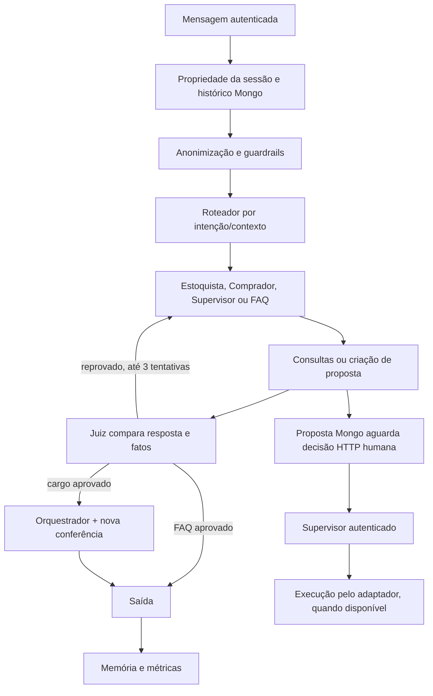

# Inventário Técnico e Funcional da IAI INVENTRA

**Versão:** 2.0 — **Data:** 14/10/2026  
**Base:** código desta branch após implementação; decisões do responsável em 14/10/2026.
O inventário anterior é referência de requisitos, não comprovação de execução.

## 1. Evidência e classificação

- **IMPLEMENTADO E FUNCIONAL:** capacidade interna exercitada localmente, com dependências
  necessárias. Não significa integração externa validada.
- **IMPLEMENTADO COM MOCK:** fluxo executável/testado, com identidade, negócio, persistência
  ou modelo substituídos explicitamente.
- **PREPARADO PARA INTEGRAÇÃO:** adaptador/contrato existe; ambiente ou capacidade externa falta.
- **NÃO IMPLEMENTADO:** código correspondente ainda não existe.

A suíte utiliza mongomock. Não foram fornecidos MongoDB real, API Spring executando ou
credenciais reais de Gemini/Groq. Os testes HTTP do adaptador Spring simulam respostas.
Não declarar integração externa real com base nesses testes.

## 2. Estado da entrega

| Capacidade | Estado e evidência |
|---|---|
| FastAPI e contratos tipados | IMPLEMENTADO E FUNCIONAL; rotas exercitadas com cliente HTTP local |
| FAQ textual por pergunta | IMPLEMENTADO E FUNCIONAL; arquivo revisado e recuperação com fontes |
| Interpretação geral por LLM | PREPARADO PARA INTEGRAÇÃO; agentes conectados, sem avaliação de provedores reais |
| Intérprete offline | IMPLEMENTADO COM MOCK; demonstração determinística limitada, explicitamente identificada |
| Consultas do domínio | IMPLEMENTADO COM MOCK; adaptador Spring pronto, HTTP real não validado |
| Propostas/aprovação/execução demo | IMPLEMENTADO COM MOCK; fluxo completo, concorrência, expiração e auditoria testados |
| Autenticação demonstrativa | IMPLEMENTADO COM MOCK; identidades fixas, não arbitrárias |
| Autenticação por JWT | PREPARADO PARA INTEGRAÇÃO; validação online no Spring, sem serviço real disponível |
| Persistência Mongo | PREPARADO PARA INTEGRAÇÃO; PyMongo e índices implementados; teste real opt-in não executado |
| Histórico e isolamento | IMPLEMENTADO COM MOCK no ambiente testado; caminhos do Mongo real implementados |
| Caixa de entrada do Supervisor | IMPLEMENTADO COM MOCK; notificação persistente por leitura/polling |
| Página externa de aprovação | NÃO IMPLEMENTADO nesta branch; contrato documentado |
| Delegação autenticada do solicitante | PREPARADO PARA INTEGRAÇÃO; nenhum endpoint Spring inventado |
| Idempotência completa entre serviços | PREPARADO PARA INTEGRAÇÃO; IAI bloqueia repetição, backend ainda precisa reconciliar |
| Edição real de contagem | PREPARADO PARA INTEGRAÇÃO; não há endpoint documentado |
| Remoção lógica real de item | PREPARADO PARA INTEGRAÇÃO; DELETE documentado não comprova preservação lógica |
| Push/e-mail/WhatsApp | NÃO IMPLEMENTADO; inbox é o canal atual |
| OCR/cadastro por foto | NÃO IMPLEMENTADO pela IAI |
| Métricas | IMPLEMENTADO E FUNCIONAL em testes com persistência mock; latência, erros, agentes, tokens reportados e custo configurável |

## 3. Arquivos e arquitetura

| Módulo | Responsabilidade |
|---|---|
| main.py | FastAPI, CORS explícito, lifespan, expiração, saúde e métricas |
| config.py / iai/.env.example | modos independentes, URLs, timeout, segredos e configuração demonstrativa |
| schemas.py / domain.py | contratos de chat, grafo, consultas, 16 operações, propostas/decisões/resultados |
| security.py | Bearer, validação de identidade, papel/cozinha, ContextVar fora do estado do modelo |
| privacy.py / guardrail.py | remoção de segredos, anonimização PII, filtros e classificadores |
| llms.py / prompts.py | provedores e prompts sincronizados às ferramentas reais |
| graph.py / judge.py | grafo, roteamento, especialistas, auditoria e formatação conferida |
| demo.py | grafo separado de demonstração sem LLM |
| retrieval.py / tools/faq.py | recuperação textual e indicação de linhas do FAQ |
| tools/operational.py | consultas autorizadas e ferramentas que criam propostas; nenhuma decisão/execução |
| business.py | protocolo de negócio, Spring HTTP e adaptador mock do domínio |
| approvals.py | proposta imutável, decisões, CAS, execução, estados e auditoria |
| memory.py / tools/memoria.py | mensagens, resumos e busca textual por usuário/cozinha |
| storage.py | cliente Mongo lazy e mongomock explícito; índices criados no startup |
| metrics.py | métricas sem conversa, credenciais ou motivo textual do juiz |
| routes/ | chat, consultas e aprovação autenticados |
| compose.yaml / Dockerfile / .dockerignore | execução local opcional e exclusão de segredos/dependências de teste da imagem |
| docs/INTEGRACAO_FRONTEND.md | contrato executável da página e arquitetura de JWT |

### Arquivos criados e alterados

Novos módulos: domain.py, security.py, storage.py, privacy.py, approvals.py, business.py,
metrics.py, retrieval.py, demo.py, tools/operational.py, routes/approvals.py e routes/queries.py.
Novos artefatos: iai/.env.example, compose.yaml, .dockerignore e os dois documentos em docs.
Novos testes: test_api, test_approvals, test_business, test_external_services, test_live_graph,
test_metrics, test_operations, test_query_relations e test_tools_and_security; helper tests_helpers.py.
Atualizados: grafo, prompts, guardrails, juiz, LLMs, schemas, configuração, main, memória,
rotas de chat, ferramentas de FAQ/histórico, FAQ JSONL, testes existentes, conftest, README,
requirements.txt, Dockerfile e .gitignore.

Não há frontend na estrutura disponibilizada. Nenhum outro repositório foi modificado.
Os imports não criam índices nem fazem conexões Mongo síncronas.
O Dockerfile usa /opt/venv acessível ao usuário não-root, em vez de executáveis sob /root.

## 4. Fluxo LangGraph live

Roteador considera histórico e pergunta atual. Mensagem sem protocolo de rota não pode
virar resposta operacional sem fatos; nesses casos segue ao Supervisor.
Saudações simples usam resposta segura. Histórico consultado é conferido pelo juiz.
Questões de várias áreas seguem ao Supervisor, com consultas e FAQ.

O juiz usa confiança mínima 0,7 e até três tentativas. A saída do orquestrador é
conferida novamente; se ele alterar fatos, é preservada a resposta já validada.
Confirmações de criação de proposta vêm do documento persistido, não do texto do modelo.
Nenhum modelo recebe ferramenta para decidir ou executar uma aprovação.

O antigo MemorySaver foi substituído pela reidratação das últimas 30 mensagens visíveis
do Mongo em cada rodada. Isso evita misturar checkpoints de usuários com session_id igual,
restaura o contexto visível após reinício e não armazena JWT/checkpoints de ferramentas.
A sessão é identificada pelo conjunto usuário/cozinha/session_id e pelo ID interno.

## 5. Agentes e modelos

- **Roteador:** llm_rapido, buscar_historico; seleciona intenção, não concede autorização.
- **Estoquista:** consultas, FAQ, histórico e sete propostas de lotes/movimentos/inventários.
- **Comprador:** consultas, FAQ, histórico e seis propostas de fornecedores/requisições.
- **Supervisor:** consultas, FAQ, histórico e todas as 16 propostas; não decide pelo humano.
- **FAQ:** apenas recuperação documental.
- **Juiz/orquestrador/resumo:** verificam fatos, formatam e resumem; não aprovam operações.

Modelos preservados: Gemini gemini-2.5-flash (especialistas) com fallback Groq;
Groq openai/gpt-oss-20b (roteador/FAQ/juiz/formatação/resumo);
Groq openai/gpt-oss-safeguard-20b (moderação).
Modo live exige chaves; placeholders de construção não habilitam chamadas reais.
Temperaturas e divisão de provedores foram preservadas.

**Demo:** não usa esses modelos. Demonstra consumo em kg com algumas variações e múltiplos
produtos, consultas simples e FAQ. Não é compreensão semântica geral. Demais operações
podem ser demonstradas pelo contrato estruturado; atendimento natural completo depende
do modo live. Tests com modelo roteirizado validam integração de tools/grafo, não inteligência.

## 6. Ferramentas e consultas

Ferramentas compartilhadas: consultar_inventra, consultar_solicitacoes_iai,
faq_retriever e buscar_historico. Fontes documentais e operacionais permanecem distintas.

Query permite produtos, saldo, lotes, validade, estoque mínimo, fornecedores, recorrência
por lotes recebidos, requisições/itens, inventários/contagens, alertas, categorias,
unidades e cozinha, vínculos produto–fornecedor e parâmetros do produto por cozinha.
O filtro mine usa exclusivamente o usuário autenticado para requisições/inventários.
IDs, datas, filtros e paginação são validados.
Não aceita SQL, URL, identidade ou cozinha decididos pelo modelo.
Catálogo público dentro da API exige autenticação; Spring aplica permissões reais.

SpringGateway usa somente rotas documentadas. Filtros não existentes no HTTP são
aplicados apenas sobre resultados já autorizados. Arrays são limitados/paginados para
contexto; resultados parciais têm incomplete=true. Página Spring mantém seus metadados.
Recorrência significa número de lotes recebidos por fornecedor, não frequência de compras.

Retornos: ok, code, message, data, source, mocked, incomplete e request_id opcional.
Resultado vazio, falta de autorização, conflito, falha de serviço e JSON inválido diferem.
Tipos mínimos, referências, quantidades, cozinha e códigos HTTP específicos da operação são conferidos.
Resposta 2xx fora do contrato não confirma criação; uma escrita pode ficar incerta.
Campos/strings de credenciais são removidos de dados externos antes de virar evidência.

MockGateway usa produtos Arroz/Carne/Tomate, lotes, fornecedores e registros de exemplo.
Os dados ficam em business_mock, segregados por cozinha. Quantidades não são produção.
O mock cobre regras necessárias aos exemplos, mas não replica todas as constraints,
procedures, triggers, auditorias ou permissões do PostgreSQL/Spring.

## 7. Operações disponíveis

Cada operação possui modelo Pydantic próprio e uma tool `propor_<operação>`.
Todas criam proposta; não modificam estoque/cadastro nessa chamada.

| Operação | Agente principal | Integração de execução |
|---|---|---|
| criar_produto | Supervisor | mock completo; adaptador Spring implementado |
| editar_produto | Supervisor | mock completo; adaptador Spring implementado |
| desativar_produto | Supervisor | desativação, sem DELETE |
| cadastrar_fornecedor | Comprador/Supervisor | mock completo; adaptador Spring implementado |
| desativar_fornecedor | Comprador/Supervisor | desativação, sem DELETE |
| criar_lote | Estoquista/Supervisor | entrada nova |
| registrar_entrada | Estoquista/Supervisor | reposição de lote existente |
| registrar_saida | Estoquista/Supervisor | consumo de lote |
| ajustar_estoque | Estoquista/Supervisor | quantidade absoluta não negativa |
| criar_requisicao | Comprador/Supervisor | solicitante original; criação separada dos itens |
| adicionar_item_requisicao | Comprador/Supervisor | depende de ID existente, não de ID inventado |
| remover_item_requisicao | Comprador/Supervisor | mock torna inativo; real aguarda remoção lógica confirmada |
| cancelar_requisicao | Comprador/Supervisor | status CANCELLED |
| registrar_inventario | Estoquista/Supervisor | inventário OPEN; um aberto por cozinha |
| registrar_contagem | Estoquista/Supervisor | contagem física em inventário aberto |
| alterar_contagem | Estoquista/Supervisor | mock edita; real aguarda endpoint |

Não existem exclusão física, SQL livre, fechamento de inventário, aprovação de requisição
de negócio, edição de usuário/perfil/cozinha ou envio ao fornecedor pelas tools desta entrega.
Consultas não exigem aprovação. Metadados internos de conversa/métricas/proposta são
persistidos pela própria IAI; isso não é alteração de dados operacionais do INVENTRA.

## 8. Proposta, decisão, execução e auditoria

Proposta estruturada: ID durável, requester, requester_id, kitchen_id, action/parameters,
before, justification, proposal_hash, idempotency_key, created_at, expires_at, status,
decided_by/decision/decided_at/decision_reason, result, execution_error, technical_executor,
business_mode, notification e eventos audit.

IDs/referências são consultados antes de persistir. Datas, quantidades, estados e existência
são rechecados; lotes vencidos, saldo insuficiente e inventários/estados incompatíveis
são bloqueados. Backend também deve conferir todas as regras durante a execução.

Qualquer Supervisor da mesma cozinha pode decidir, inclusive o solicitante Supervisor.
A decisão exige o hash da proposta. Dados alterados invalidam a integridade; não há edição
in-place. O retrato do registro é comparado novamente antes de executar.
Mudança de modo mock para real não executa uma proposta do ambiente anterior.

Estados: AGUARDANDO_APROVACAO, APROVADA_PENDENTE_INTEGRACAO, RECUSADA,
EM_EXECUCAO, CONCLUIDA, FALHOU, EXPIRADA, RESULTADO_INCERTO.
Dados incompletos são esclarecidos antes da proposta; não criamos uma execução fictícia.

Sete dias de validade. Trabalhador verifica expiração a cada 30 segundos; leituras/decisões
também materializam o estado. Não há TTL que apague auditoria.
Quantidades decimais são normalizadas: 10, 10.0 e 10.000 produzem o mesmo fingerprint
na mesma rodada. CAS find_one_and_update permite uma única transição para execução. Clique/requisição
repetidos retornam estado existente. Chaves diferentes para a mesma intenção constituem
solicitações diferentes; frontend deve preservar request_id/idempotency_key em retries.

Mock mantém ledger execution_mock. Escrita HTTP real é enviada uma vez, sem header
inventado de idempotência. Timeout/erro de confirmação gera RESULTADO_INCERTO, sem retry.
Execução interrompida por dez minutos fica incerta. Não há reexecução administrativa
automática. Operações em propostas diferentes não constituem uma transação de grupo.

Persistência de decisão, CAS e auditoria usam o documento da proposta. Mongo não participa
da transação do PostgreSQL. Garantias distribuídas completas exigem backend com chave
idempotente, consulta de estado e validação transacional/versionamento do alvo.

## 9. Identidade, permissões e delegação

Mock autentica somente identidades demo fixas; não é JWT real. Modo Spring valida por
/api/users/me a cada chamada, incluindo perfil, atividade e cozinha.
Body/URL user_id não concedem acesso. Histórico é do proprietário mesmo para Supervisor.
Permissões manuais continuam no Spring; aprovação IAI não contorna HTTP 403 do backend.

JWT fica apenas em RequestContext/SecretStr fora de mensagens e configuração do grafo.
Não se armazena token para esperar sete dias. API real recusa identidade mock.
Solicitante, aprovador e executor técnico são campos diferentes.

Sem delegação de outro solicitante, aprovação real permanece pendente. O próprio
solicitante pode apresentar JWT fresco ao endpoint execute; Spring mantém sua atribuição
e decide as permissões. O token do Supervisor não representa outro usuário.
Arquitetura recomendada de delegação futura está no contrato do frontend.

## 10. FAQ, memória, segurança e métricas

FAQ revisado tem 24 pares: remove promessas de OCR/telas/envio não verificadas; distingue
produto/lote, estados de requisição/proposta, aprovação obrigatória, mocks e pendências.
Recuperação textual ranqueia até quatro entradas, com normalização/sinônimos e fonte/linha.
Não há embeddings, índice vetorial, RAG semântico ou sincronização automática com web.
Fonte oficial desta revisão: decisões fornecidas, código desta branch e contrato público,
sem inventar caminhos de navegação externos.

Memória aceita busca textual entre até 200 resumos recentes do próprio usuário/cozinha.
Sessões encerram explicitamente. Histórico visível exclui avaliações do juiz.
Sessões antigas sem kitchen_id/active não são automaticamente atribuídas a alguém;
migração dos dados legados exige mapeamento autenticado confiável.

Guardrails live preservam regex de injeção, anonimização de e-mail/CPF/RG/telefone,
classificação de abuso/escopo e bloqueio em falha. Segredos não entram no mapa de restauração.
Guardrail de saída ainda restaura PII; não equivale a moderação geral completa.
Regex e juiz probabilístico não garantem cobertura absoluta nem autorização.
Dados externos/histórico são tratados como evidência, nunca autorização/instrução.
O demo só usa filtro determinístico; não simula moderação de LLM como segurança real.

Métricas armazenam latência de rodada, status técnico, nomes de agentes e usage_metadata
quando o provedor reporta tokens. Não armazenam conversa, JWT ou motivo textual do juiz.
Custo só é estimado com IAI_MODEL_PRICES_JSON completa (USD por milhão input/output);
sem dados/tabela, fica nulo. Não equivale a fatura. Não há preço de mercado presumido.
Falhas inesperadas do SDK retornam erro neutro, com tipo da exceção nas métricas;
não expõem mensagens de exceção que possam conter credenciais.
Projeções de receita, resolução de negócio e latência individual por nó não foram
implementadas; o status ok significa execução técnica do chat, não compra/baixa concluída.

## 11. Ambiente, testes e limites da comprovação

requirements.txt preserva stack e versões principais; adiciona httpx e mongomock.
datetime e uuid são biblioteca padrão e não devem ser instalados como pacotes homônimos.
O ambiente local recomendado é Python 3.12 com `.venv`; o README seleciona esse
interpretador explicitamente no Windows. `jq` e `psycopg2-binary` foram removidos
dos requisitos porque não são importados pela IAI; PostgreSQL é acessado pelo Spring.
Default seguro: spring/spring/mongo/live; demonstração exige configuração explícita.
INVENTRA_API_URL configurável; HTTPS fora de localhost; timeout padrão 10 segundos.
CORS não usa origem curinga. Configuração e execução estão em README e .env.example.

Testes cobrem domínio, tools, grafo com agentes LangChain/modelo roteirizado, endpoints,
aprovação concorrente, expiração, hash/alteração, idempotência, timeout, identidade,
isolamento de cozinha/usuário/sessão, FAQ, memória e métricas.
Mongomock não prova semântica de transações/índices do Mongo real.
httpx simulado não prova contratos implantados ou permissões executadas no Spring.

**Resultado final (14/10/2026):**

- Pytest: **127 testes aprovados, 4 ignorados**; cobertura de **88,19%** em iai.
- Ruff: projeto completo sem erros (ruff check .).
- Mypy: 24 módulos sem erros, com follow-imports=skip; dependências não foram analisadas.
- git diff --check: sem erros de whitespace.
- Serviço Uvicorn temporário em localhost: fluxo HTTP demonstrativo validado e servidor encerrado.
- Exemplo de almoço: duas propostas, arroz 50→40 kg e carne 100→60 kg somente após aprovação; todos os dados eram MOCK.
- OpenAPI e catálogo de 16 operações conferidos pela API local.
- Docker/Compose, Mongo real, Spring real e modelos reais não foram executados/validados.

**Verificação adicional do ambiente Windows (14/10/2026):** Python 3.12.10 instalado,
ambiente `.venv` criado e `requirements.txt` instalado integralmente. `pip check`
não encontrou dependências incompatíveis. Uvicorn iniciou nesse ambiente; `/health`,
`/docs`, consulta de estoque, chat com proposta pendente e inbox do Supervisor
retornaram HTTP 200, com auth/business/storage mock e intérprete demo explícitos.
Essa verificação corrige a instalação incompleta feita anteriormente com Python 3.15
e não comprova serviços externos reais. A configuração demo local permanece fora do Git.

Testes externos opcionais permanecem ignorados quando não configurados:
Gemini/Groq, Mongo temporário real e leitura da API Spring de homologação.
Não foram realizadas escritas reais no estoque nem modificações em outros repositórios.

## 12. Dependências externas e próximos responsáveis

1. Publicar/disponibilizar Spring e validar OpenAPI/DTOs/controllers da revisão implantada.
2. Definir delegação segura em nome do solicitante, idempotência e reconciliação no backend.
3. Disponibilizar edição de contagem e remoção lógica de itens compatíveis com retenção.
4. Implementar a página de aprovação no frontend externo e consumir inbox/detalhe/decisão.
5. Validar Mongo real, credenciais LLM, operação real em homologação e qualidade linguística.
6. Definir retenção, backup, acesso de auditoria, política de traces e proteção de gateway.
7. Validar build Docker e eventual implantação; Vercel/AWS não foram configurados.
8. Migrar histórico legado somente com identidade/cozinha confiáveis.

Nenhuma dessas dependências foi mascarada como integração real. Os fluxos locais
demonstrativos e contratos são entregues para permitir sua substituição gradual.

## Referências

- Código desta branch, README, .env.example e testes.
- Decisões do responsável recebidas em 14/10/2026.
- [Contrato público Spring consultado](https://raw.githubusercontent.com/InventraTech/inventra-development-spring-redis-neo4j-2/main/docs/docs.md).
- Inventário v1.0 fornecido (11/10/2026), preservado em sua localização original.
